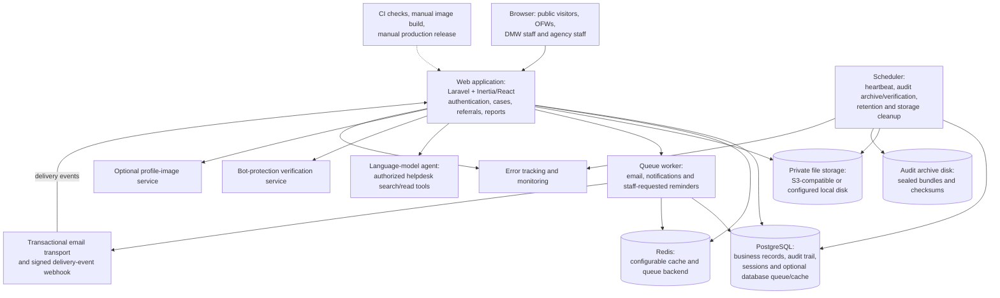

# System Architecture — High-Level with Services

> **Version:** 9.6.0 | **Reconciled:** 2026-11-01 | **Audience:** DICT + general reviewers
> **Scope:** Application capabilities and configurable infrastructure, not a verified inventory of a live deployment.
> **Sources:** `Dockerfile`, `docker/supervisord.conf`, `docker-compose.yml`, `config/`, `resources/js/app.tsx`, current routes and services. Earlier environment-specific assumptions are superseded by this capability view.

## Diagram

## Boundaries and operating choices

- Application image contains the web runtime, queue worker and scheduler programs. Deployment flags decide which run in each instance; keep one active scheduler across a scaled deployment.
- PostgreSQL holds business records. Redis is available for cache and queues; database drivers are also supported. Local Compose defaults and deployment overrides need not match. See [Redis Integration](REDIS_INTEGRATION_v2.1.0.md).
- File uploads through `StorageService` invoke the configured scanner before storage. `MALWARE_SCANNER=null` performs no real scan; scanner unavailability can fail open when `MALWARE_FAIL_OPEN=true`. Do not equate an accepted upload with a successful malware scan.
- Private downloads use expiring storage URLs, or an application-signed temporary-file route for disks without native temporary URLs. Profile images can use the optional image service instead.
- Chatbot answers are generated by a language model. Weighted keyword ranking retrieves helpdesk evidence; it is not the answer engine. No vector database is required.
- PSGC reference data is generated into a frontend data file and parsed server-side; ordinary address selection does not require a live external lookup.
- Report exports run synchronously during the request, not in the queue. Overdue reminders require a staff action, not a scheduled sender.
- Release workflow runs migrations inside the container and gates rollout on `/up`. `/api/readyz` is a separate token-protected deep monitoring probe, not the platform liveness probe.

See [Architecture](ARCHITECTURE_v2.2.0.md), [Deployment Guide](DEPLOYMENT_GUIDE_v3.1.0.md), and [CI/CD Guide](CI_CD_GUIDE_v2.1.0.md) for contracts and operational limits.
