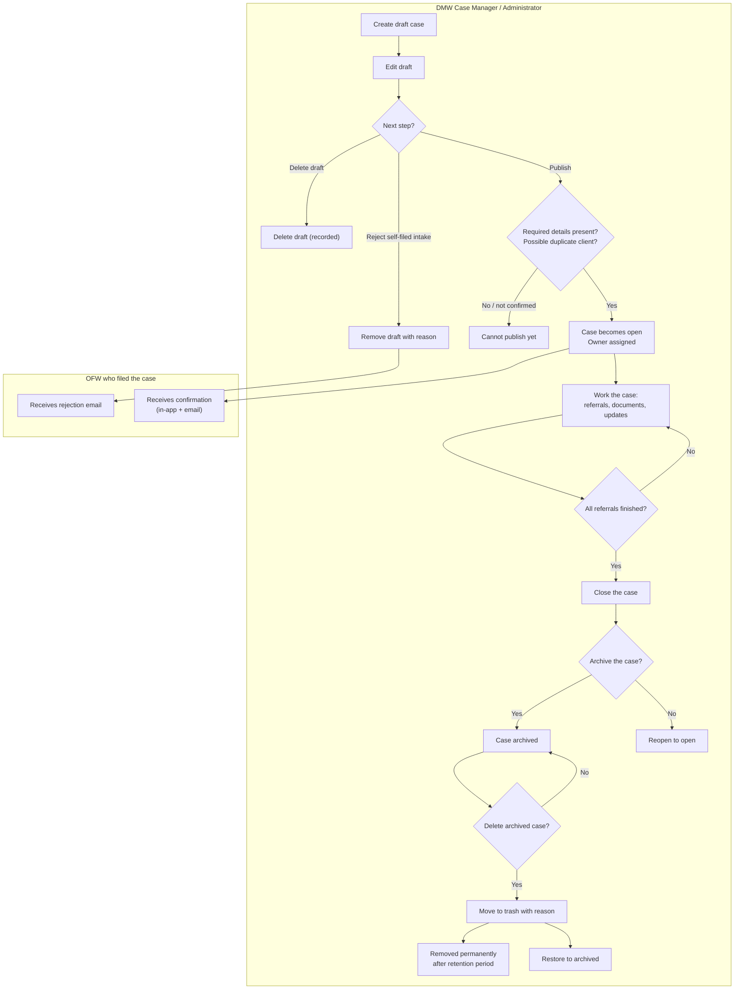
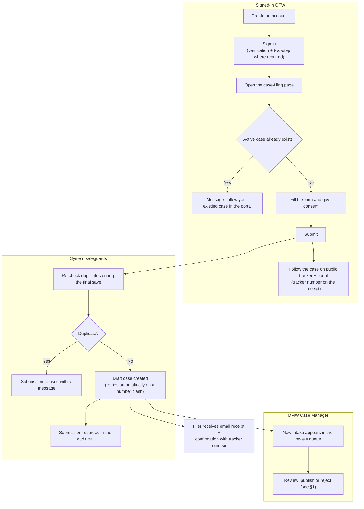
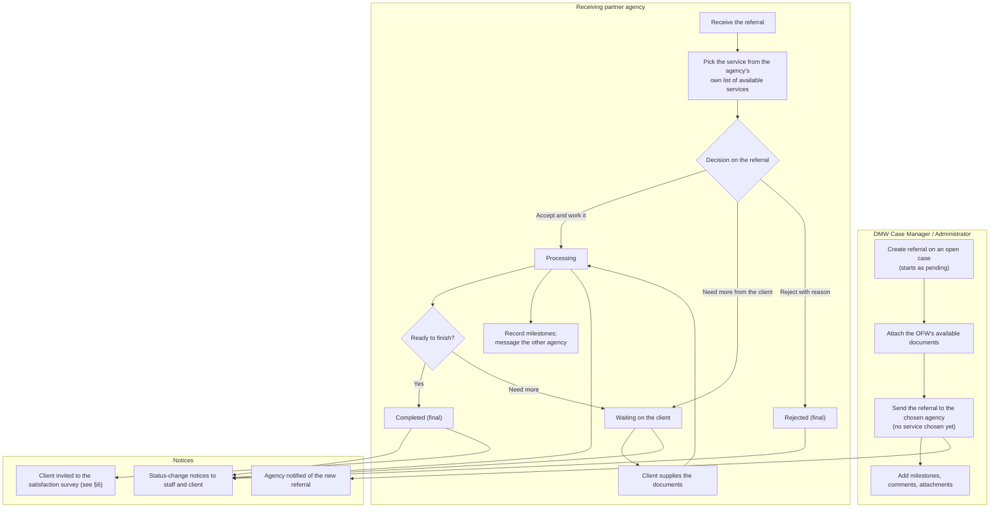
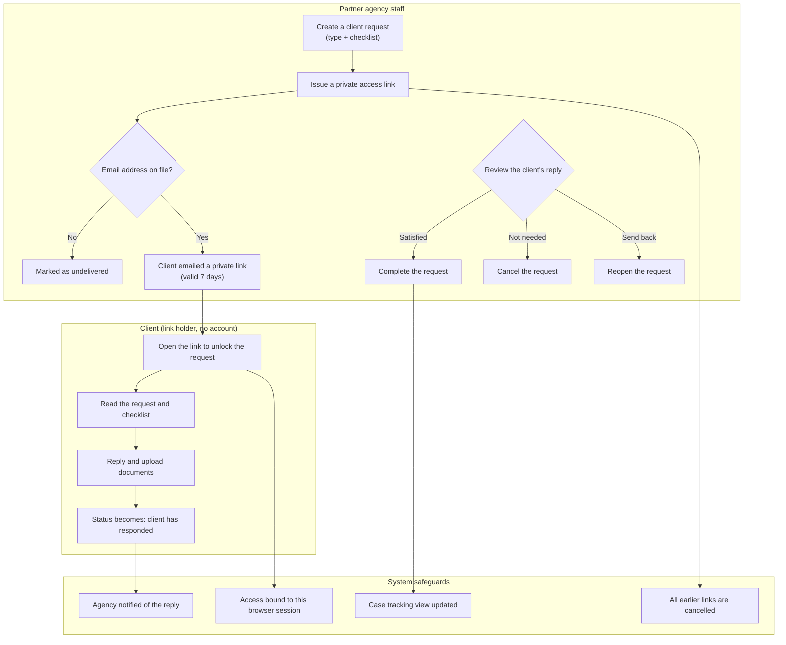
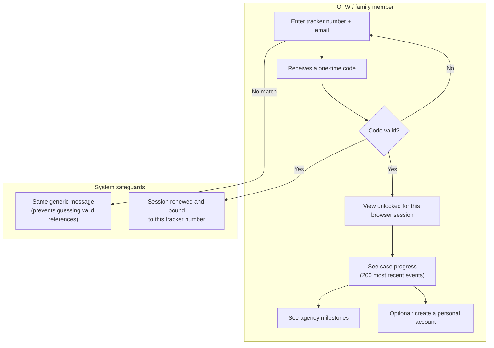
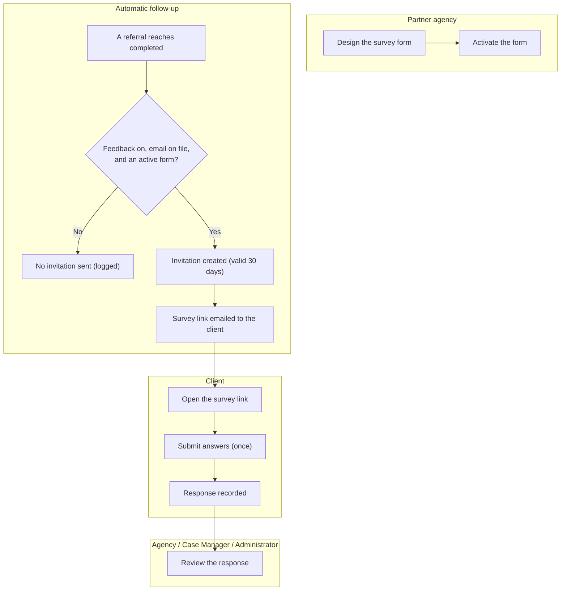
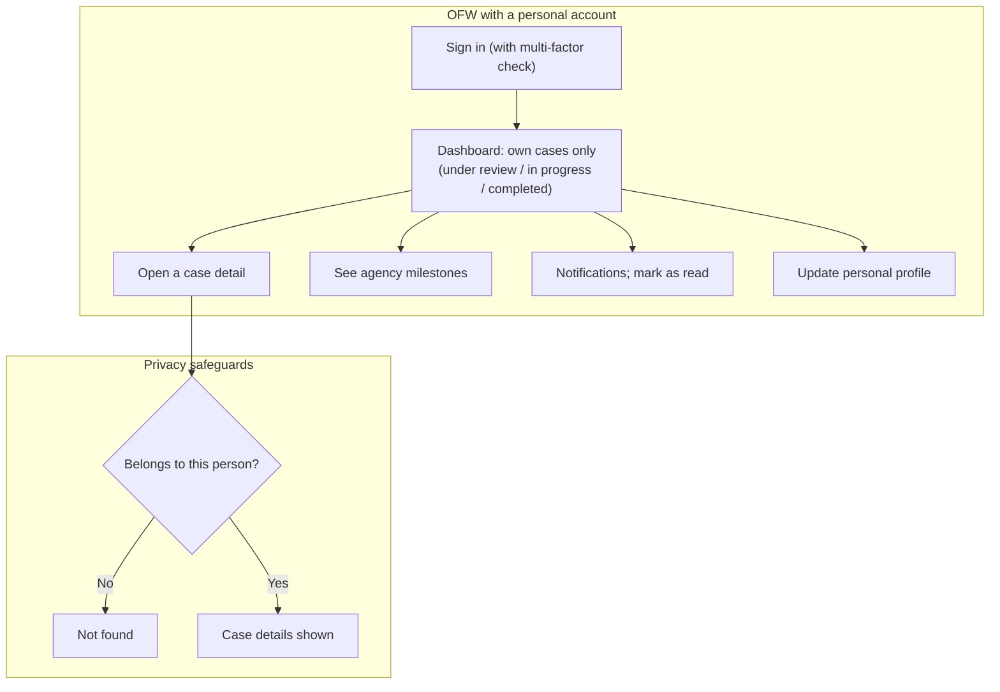

# One Window Bayanihan — Business Process Flows

> **Document:** 02 — Business Process Flows (System Analysis and Design series)
> **Version:** 1.1.0
> **Date:** 2026-10-11
> **Status:** CURRENT
> **Audience:** DICT reviewers, capstone panelists, and business stakeholders
> **Companion:** [01-system-description.md](01-system-description.md) (system description, features, status)

## How to read this document

Each of the seven processes below describes a complete business flow in plain terms: what it is for, who starts it, what must be true first, the steps in order, the decisions and exceptions, the notifications that go out, and the end result. Where a flow is only partially captured, the section says so in plain words ("Partially described"). Diagrams show only actors, actions, and decisions — no system internals.

Terminology:

- **Case file** — the unified record of one OFW's situation. A case moves through these states: **draft**, **open** (being worked), **closed**, **archived**, and finally removed after a retention period.
- **Intake** — a case the OFW files themselves through the public portal, before a Case Manager reviews it.
- **Referral** — an open case routed to a partner agency; after it arrives, the agency picks the service it will deliver from its own list of available services. A referral moves through: **pending**, **processing**, **waiting on the client** (compliance needed), **completed**, or **rejected**.
- **Client request** — an agency's request for documents, answers, or information updates from the client, delivered through a time-limited private link.
- **Tracker number** — the case reference used to follow a case on the public tracker with an email code, and in the portal when signed in (shown on the filing receipt).

---

## Table of contents

1. [Case lifecycle (draft → publish → close → archive → removal)](#1-case-lifecycle-draft--publish--close--archive--removal)
2. [Self-filing (OFW intake, after signing in)](#2-self-filing-ofw-intake-after-signing-in)
3. [Referral to partner agencies](#3-referral-to-partner-agencies)
4. [Document request inbox (agency ↔ client)](#4-document-request-inbox-agency--client)
5. [Case tracking (public tracker and portal view)](#5-case-tracking-public-tracker-and-portal-view)
6. [Client satisfaction survey](#6-client-satisfaction-survey)
7. [OFW personal portal](#7-ofw-personal-portal)
8. [Rules that apply to every process](#8-rules-that-apply-to-every-process)

---

## 1. Case lifecycle (draft → publish → close → archive → removal)

### Purpose

Move a case from creation to its final archived or removed state, while enforcing who may act, what must be true before each step, and a complete audit trail.

### Who starts it

A DMW Case Manager (or an Administrator) creates a case in the staff portal. Drafts also arrive from public self-filing (see §2).

### Who is involved

- **Case Manager** — primary owner; drafts, publishes, and closes cases.
- **Administrator** — oversight; can also view and manage cases.
- **Agency staff** — participate through referrals on open cases; they are not lifecycle decision-makers. **Partially described:** exactly which case screens agency staff can see was confirmed only at the general access level, not exhaustively for every case detail view.

### What must be true first

- The person is signed in, their account is active, and they have completed the multi-factor check.
- A Case Manager may only edit or publish their own drafts — except self-filed intakes, which are unassigned until a reviewer publishes them.

### Steps in order

1. **Create draft** — the case is saved as a draft with a case number. If two cases happen to draw the same number, the system retries automatically (up to three times) before failing.
2. **Edit draft** — the draft is updated; the system checks it is still a draft before saving (so two people cannot silently overwrite each other).
3. **Publish** — a Case Manager or Administrator reviews the draft and decides: publish, reject, or delete (see decisions below).
4. **Work the case** — status updates, referrals to agencies (§3), documents, comments; every change is recorded in the audit trail.
5. **Close** — allowed only when no referral is still unfinished.
6. **Archive** — allowed only for closed cases that still pass the close check; a closed case can also be reopened.
7. **Delete archived** — moves the case to trash with a mandatory reason; it can be restored from trash.
8. **Remove permanently** — trashed cases past the retention window are removed automatically by a nightly routine.

### Decisions

| Decision | Rule |
|---|---|
| Publish a self-filed intake? | Any Case Manager or Administrator may publish; ownership is assigned at the moment of publishing. |
| Is this a duplicate client? | The system checks for an existing client; the publisher can confirm and proceed if it truly is the same person. |
| Is the draft complete? | Publishing is blocked until the required information is present. |
| Can the case be closed? | Not while any referral is still pending, processing, or waiting on the client. |
| Can the case be archived? | Only if it is closed and still passes the close check. |

### Exceptions

- **Reject a self-filed intake** — the draft is removed with a recorded reason, and the filer receives a rejection email.
- **Delete a draft** — removed with an audit entry in the same step.
- **Simultaneous edits** — the second person's save is rejected rather than overwriting newer information.

### Notifications

- Publishing a self-filed intake: the OFW receives an in-app notice and an email confirming their case is now open.
- Rejection: the filer receives an email.
- **Partially described:** staff-side notices on routine case updates exist, but the exact list of which events raise them was not fully enumerated.

### End result

The case ends as **open** (being worked), **closed** (resolved, reopenable), **archived** (closed history), or **removed** after the retention period (final).

### Business rules

- Only the owner may edit or publish their own drafts (self-filed intakes are unassigned until publish).
- Publishing is recorded as exactly one audit entry, not a trail of internal steps.
- A case cannot close while any referral is unfinished.
- Deleting requires a reason; permanent removal happens only after the retention window.

### Flowchart

---

## 2. Self-filing (OFW intake, after signing in)

### Purpose

Let a signed-in OFW (or a family member with an account) open a case from inside the portal, under verified, rate-limited conditions with duplicate protection. Filing requires an account — there is no filing path without one.

### Who starts it

A signed-in OFW, from the case-filing page in the portal.

### Who is involved

- **OFW** — the filer, already signed in.
- **Case Manager** — the downstream reviewer who receives the draft into the intake queue (see §1).

### What must be true first

- The filer has created an account and is signed in (with verification and the two-step check where required).
- Abuse protections (attempt limits, optional bot check) apply throughout.

### Steps in order

1. **Create an account** — a new visitor registers and confirms their email before anything else.
2. **Sign in** — the OFW signs in (with verification and the two-step check where required).
3. **Duplicate check** — before the form is shown, the system checks whether this person already has an active case.
4. **Submit** — the filer completes the form and consent, and submits. The system re-checks duplicates at this moment (protecting against two simultaneous submissions), then creates the draft case.
5. **Receive receipt and track on both paths** — after the case is safely saved, the filer receives an email receipt and an in-app confirmation carrying the **tracker number**, and follows the case on the public tracker with an email code as well as in the portal when signed in; Case Managers are notified that a new intake awaits review.

### Decisions

| Decision | Rule |
|---|---|
| Already has an active case? | Blocked before the form is shown, again before submitting, and once more inside the final save — the filer is directed to their portal view instead. |
| Not signed in? | Filing is not offered; the visitor is directed to create an account and sign in first. |

### Exceptions

- Two identical submissions racing each other → one succeeds, the other is told an active case already exists.

### Notifications

- **Case Managers:** notice of a new intake, which appears in the review queue.
- **Filer:** email receipt plus an in-app confirmation with the tracker number — both sent only after the case is safely saved.

### End result

A draft, self-filed case sitting in the intake queue, waiting for Case Manager review, linked to the filer's account and visible in their portal.

### Business rules

- An account and sign-in are required before filing — filing without an account is not offered.
- One active case per person — duplicates are blocked at three separate moments.
- Consent is captured with the form.
- The tracker number is given to the filer immediately so they can follow the case on the public tracker with an email code, and in the portal when signed in.

### Flowchart

---

## 3. Referral to partner agencies

### Purpose

Route an open case to a partner agency and drive it to a final outcome, with clear ownership rules and full notification and audit coverage. The office sends the referral with the OFW's documents attached; the receiving agency chooses which of its own services the referral covers.

### Who starts it

A DMW Case Manager (or an Administrator) creates a referral on an open case and sends it to the partner agency they have chosen.

### Who is involved

- **Sending Case Manager / Administrator** — creates the referral, attaches the OFW's available documents, and sends it to the chosen agency; they do not choose the service.
- **Receiving agency staff** — receive the referral, pick the service from their own list of available services, and own its progress through to completion.
- **OFW client** — supplies any further documents when asked; receives status notifications; not a direct actor in this process.

### What must be true first

- The case exists and is open, and the person acting is authorized for it.
- The OFW's available documents are attached before the referral is sent.
- The agency user belongs to a partner agency; agencies only see referrals sent to their own agency.

### Steps in order

1. **Send referral** — the Case Manager or Administrator attaches the OFW's available documents and sends the referral to the chosen agency; no service is chosen at this point. Status starts as **pending**, the agency is notified, and the documents are stored first (if storage fails, nothing is sent and no half-saved referral remains).
2. **Agency picks the service** — the receiving agency chooses the service from its own list of available services. Only the receiving agency may do this.
3. **Agency engages** — the receiving agency chooses what happens next: start processing, put it back on the client (waiting on compliance), or reject with a reason. Only the receiving agency may make this move.
4. **Compliance loop** — while waiting on the client, the client supplies documents (through §4 or other channels); the agency returns it to processing when satisfied.
5. **Complete** — processing finishes and the referral becomes **completed**; this is the moment that triggers the satisfaction survey (§6).
6. **Milestones and collaboration** — progress milestones, comments, attachments added by the sending office, and a private message thread with the other agencies on the case.
7. **Overdue watch** — referrals idle past a threshold (7 days by default) appear on an administrator's dashboard, with manually sent reminders.

### Status rules

| From | Allowed to |
|---|---|
| **Pending** | processing, waiting on client, rejected |
| **Processing** | waiting on client, completed, rejected |
| **Waiting on client** | processing, completed, rejected |
| **Completed** | final — no further changes |
| **Rejected** | final — no further changes |

Setting the same status again changes nothing and never re-sends notifications.

### Decisions

| Decision | Rule |
|---|---|
| Who picks the service? | The receiving agency, from its own list of available services. The sending Case Manager and Administrator do not pick it — they only attach the OFW's documents when sending the referral. |
| Who accepts or rejects? | Only the receiving agency may accept, gate, or reject a new referral. The sending Case Manager cannot dispose of it before the agency engages. |
| Rejection reason | New rejections must carry a reason; "Other" requires a short written explanation. |
| Deletion | Only Case Managers or Administrators may delete a referral. |
| Client-facing activity | Once a referral is completed or rejected, no new document requests or client replies can be added. |
| Closing the case | Referrals that are not completed or rejected block case closure (§1). |

### Exceptions

- An illegal status jump (for example, pending straight to completed) is refused with a clear message and no change is saved.
- Repeated clicks on the same status change never re-send notifications.
- If a document upload fails partway through referral creation, stored files are cleaned up.

### Notifications

- Agency staff receive an in-app notice when a referral arrives.
- Status changes and new milestones send notices to staff and emails to the client — all sent only after the change is safely saved.
- Idle referrals raise overdue notices for administrators.

### End result

**Completed** (which triggers the survey, §6) or **rejected** with a recorded reason. Both are final states.

### Business rules

- Status changes may only follow the allowed path; no skipping to completed.
- The service on a referral is picked by the receiving agency from its own list of available services; the sending Case Manager or Administrator never picks it.
- The first disposition belongs solely to the receiving agency.
- Every referral action is recorded in the audit trail.
- Referrals idle past the threshold surface for manual follow-up.

### Flowchart

---

## 4. Document request inbox (agency ↔ client)

### Purpose

Let a receiving agency ask the client for specific documents or information through a **time-limited, revocable private link** — the client needs no account — with a message thread alongside the request.

### Who starts it

An agency staff member, on a referral they are working.

### Who is involved

- **Agency staff** — create and manage requests; issue, reissue, or revoke access links.
- **Case Manager / Administrator** — see the request activity for visibility.
- **Client (OFW)** — holds the private link; replies and uploads from the tracking portal, anonymously.

### What must be true first

- The person acting can manage that referral.
- The referral is not yet completed or rejected (no new client-facing activity is allowed after that).

### Steps in order

1. **Create request** — the agency picks a type (document request, question, or information update) and, for document requests, a checklist of items; the request appears on the referral as a milestone.
2. **Issue access link** — a private link is generated, valid for **7 days**. Issuing a new link automatically cancels all earlier links. Only a sealed fingerprint of the link is stored — the link itself is never written down anywhere.
3. **Deliver** — the link is emailed to the client; if no email is on file, the request is saved and marked as undelivered.
4. **Client responds** — the client opens the link (which unlocks the request for their browser session only), reads the checklist, and replies with messages and attachments; the request becomes "client has responded".
5. **Agency closes the loop** — the agency reviews the reply and marks the request **completed**, **cancelled**, or sends it back (**reopened**).
6. **Revoke / reissue** — at any time the agency can revoke the link, or reissue (which cancels the old link and issues a fresh one).

### Decisions

| Decision | Rule |
|---|---|
| Request type | Document request, question, or information update — nothing else. |
| Request statuses | Open, in progress, client has responded, completed, cancelled. |
| Link lifetime | 7 days; a new link cancels all previous ones. |
| After the referral is final | No new client-facing requests or replies. |

### Exceptions

- Unknown, expired, or revoked link → access refused.
- Client's session expires → they are asked to open the link again.
- No client email on file → the request is saved but marked undelivered (the agency must deliver it another way).

### Notifications

- The agency receives in-app notices for delivery, revocation, and completion events.
- The client receives an email carrying the private link.

### End result

The request ends **completed** or **cancelled** (reopened while the referral still allows it); access links expire or are revoked.

### Business rules

- Links live 7 days, open the request once for a browser session only, and a new link kills the old one.
- The link itself is never stored — only a sealed fingerprint — so a database exposure cannot leak working links.
- Document requests always carry at least one checklist item.
- Everything is rate-limited to prevent abuse.

### Flowchart

---

## 5. Case tracking (public tracker and portal)

### Purpose

Give an OFW without an account visibility of their case's progress, using only a tracker number plus email proof, with limits on how much history is shown.

### Who starts it

The OFW or a family member, from the public tracking page.

### Who is involved

- **OFW / public visitor** — the tracker-number holder.
- **The system** — verifies identity and assembles the progress view.

### What must be true first

- A published case exists with a tracker number.
- The email entered matches the email on the case.

### Steps in order

1. **Request a code** — the visitor enters the tracker number and email; a one-time code is sent (rate-limited, with optional bot protection).
2. **Verify** — entering the correct code unlocks the view; on failure the session is cleared; on success the session is renewed and bound to that tracker number and email.
3. **View case progress** — the progress timeline is shown (capped at the 200 most recent events, newest first).
4. **View agency milestones** — the visitor can open the milestones recorded by each agency on the case.
5. **Optional account creation** — from this verified session, the visitor can create a personal OFW account linked to their case (existing accounts are signed in instead of duplicated).

### Decisions

| Decision | Rule |
|---|---|
| Tracker number and email match? | The same generic error is shown whether the number is wrong, unknown, or the email does not match — so nobody can guess valid case numbers. |
| How much history? | The 200 most recent events; older events are not paginated (a known shortcut). |
| What is visible? | Only published, current cases — other people's drafts and archived cases never appear. |
| Create an account? | Optional, from a verified session; an existing account is signed in rather than duplicated. |

### Exceptions

- Wrong email or unknown tracker → the same generic error; code resends are rate-limited.
- Expired session → verification must be redone.

### Notifications

None inside the tracking flow itself — the portal is pull-based. Client-facing notifications come from the case and referral processes (§1, §3, §7).

### End result

A progress view tied to the browser session, which expires with the session; no lasting public access beyond the tracker number plus a one-time code.

### Business rules

- Generic errors everywhere, to prevent guessing valid case references.
- History is capped at the 200 most recent events.
- Self-filed drafts stay visible to their own filer (so they can follow their intake); other drafts and archived cases are hidden.
- A verified tracking session can later become a full OFW account.

### Flowchart

---

## 6. Client satisfaction survey

### Purpose

Collect structured feedback from the client after a referral completes, per agency.

### Who starts it

The system starts it automatically the first time a referral reaches **completed**. The agency authors the survey form; the client completes it.

### Who is involved

- **Partner agency** — designs and activates its own survey form; reviews responses.
- **Client** — receives the invitation and completes the survey.
- **Case Manager / Administrator** — can also review responses.

### What must be true first

- Feedback collection is switched on (it is, by default).
- The case has a client with an email address.
- The agency has an **active** survey form.
- No invitation has been sent yet for the same case, agency, and referral (no duplicates).

### Steps in order

1. **Invitation created** — when all conditions hold, a private invitation is prepared, valid for **30 days**; only a sealed fingerprint of the link is stored, never the link itself.
2. **Email sent** — the survey link is emailed to the client.
3. **Client opens** — the link opens the agency's survey (rate-limited).
4. **Client submits** — one submission per invitation; the system locks the invitation so a double-click cannot record two answers.
5. **Agency reviews** — responses are listed in the portal for the agency, Case Managers, and Administrators.

### Decisions

| Decision | Rule |
|---|---|
| Feedback switched off? | No invitation is sent (quietly skipped and logged). |
| No client email or no active form? | No invitation; a warning is logged so the gap is visible. |
| Already invited? | No duplicate invitation for the same referral. |
| Deleting a form? | Blocked once the form already has invitations, so past feedback stays linked. |

### Exceptions

- Expired or invalid link → access refused.
- A second submission attempt is blocked by the lock.

### Notifications

- The client receives the invitation email.
- Agencies and staff review responses inside the portal; no further notifications fire from the survey itself.

### End result

One recorded response per invitation; the referral itself is already final (completed) and does not change.

### Business rules

- One invitation per completed referral; one response per invitation.
- Links are valid 30 days and are never stored in the clear.
- Forms cannot be deleted while responses depend on them.

### Flowchart

---

## 7. OFW personal portal

### Purpose

Give a signed-in OFW a personal view of their own cases, notifications, agency milestones, and profile — the "my cases" experience.

### Who starts it

The OFW, after signing in (with the multi-factor check), arriving at their dashboard. Accounts are created before filing, or from a verified tracking session (§5).

### Who is involved

- **OFW user** — the sole actor; strictly limited to their own file.
- **The system** — enforces that limitation on every screen.

### What must be true first

- The account is an OFW account and is linked to the OFW's client record.

### Steps in order

1. **Dashboard** — lists only this person's cases, grouped into: under review (their own self-filed drafts), in progress (open cases and referrals being worked), and completed.
2. **Case detail** — opening a case re-checks that it belongs to this person (not just the list).
3. **Agency milestones** — viewing a referral's milestones applies the same ownership check.
4. **Notifications** — lists notices tied to their cases and email; they can mark them as read.
5. **Profile** — the OFW maintains their personal record.

### Decisions

| Decision | Rule |
|---|---|
| Whose data? | Every view is limited to this person's own file; opening a case re-verifies ownership, not just the list. |
| What is visible? | Their own self-filed drafts (so they can follow their intake), open and completed cases; other people's drafts and archived cases never appear. |
| Notifications | Matched by case membership and, when present, the client email. |

### Exceptions

- Attempting to open another person's case → "not found" (with no hint that it exists).
- **Partially described:** an OFW account that is not yet linked to a client record — the exact behavior in that edge case was not fully traced; confirm with the project team.

### Notifications

In-app notices within this portal; emails on case and referral events come through the earlier processes (§1, §3).

### End result

An ongoing self-service view. The OFW changes no case state of their own — only marking notices read and editing their profile.

### Business rules

- Strictly limited to the person's own file, checked again on every detail screen.
- Self-filed drafts stay visible to their own filer; others' drafts and archived cases are hidden.
- No case actions are available to the OFW in this portal — casework stays with DMW and partner agencies.

### Flowchart

---

## 8. Rules that apply to every process

1. **Sign-in and multi-factor check** — staff and OFWs sign in with email and password, then confirm a multi-factor code (5-minute window, maximum 5 attempts before the session must restart). One-time email codes are used only for tracking, document-request links, and email changes — not for signing in, and not as a filing path without an account.
2. **Roles** — Case Manager, Administrator, Agency, and OFW; every screen and action is restricted to the roles allowed to use it.
3. **Audit trail** — every significant action is recorded as it happens; multi-step transitions are recorded as a single clean entry. The trail is integrity-checked weekly and archived monthly; records are kept one year by default.
4. **Notifications are dual-channel** — in-app notices plus emails; client-facing emails are sent only after the related change is safely saved, so a failed save never sends a misleading email.
5. **Rate limits and abuse protection** — every public form and code request is rate-limited; a bot-protection check is available for public forms (currently off by default).
6. **File handling** — uploads are malware-scanned and type-checked before storage (see the fails-open note in document 01, §13).
7. **Scheduled housekeeping** — log cleanup, audit archiving and integrity checks, orphan-file cleanup, and trash removal run on a schedule, with failure alerting.
8. **Statuses are enforced, not left to memory** — referral statuses follow the fixed path in §3; case statuses mix the fixed lifecycle (draft, open, closed, archived) with administrator-configurable categories used in reporting. **Partially described:** the exact mapping between configurable categories and the fixed lifecycle was not fully traced.

---

*Prepared 2026-10-11. Companion document: [01-system-description.md](01-system-description.md).*
