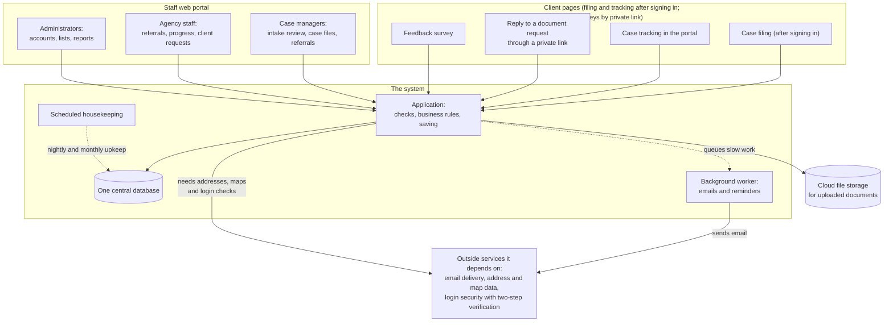
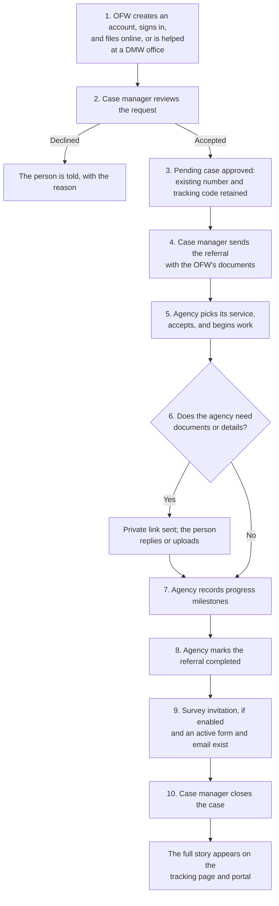

# 03 — System Flow and Architecture

> **Version:** 2.0 (plain-language rewrite) | **Date:** 2026-10-11 | **Status:** Draft for review
> **Audience:** DICT reviewers and capstone panelists — written in ordinary business English, with no code, file names, screen addresses or technical identifiers.
> **Scope:** How One Window Bayanihan works from beginning to end: how staff and the public interact with it, what happens between a request and its result, how signing in and approvals work, how files, emails and notifications move, what happens when something goes wrong, and how the system is operated and released.
> **Not covered here:** What information the system stores (see document 04, the business information model) and the detailed business rules of the office (project rules document).

---

## Table of contents

1. [What the system is for](#1-what-the-system-is-for)
2. [Who uses it](#2-who-uses-it)
3. [The overall picture](#3-the-overall-picture)
4. [What happens when someone makes a request](#4-what-happens-when-someone-makes-a-request)
5. [Signing in, two-step verification and approvals](#5-signing-in-two-step-verification-and-approvals)
6. [Files, emails and notifications](#6-files-emails-and-notifications)
7. [When something goes wrong](#7-when-something-goes-wrong)
8. [One case from start to finish](#8-one-case-from-start-to-finish)
9. [How the system is operated and released](#9-how-the-system-is-operated-and-released)
10. [Plain-language glossary](#10-plain-language-glossary)

---

## 1. What the system is for

One Window Bayanihan gives a distressed OFW in Region VII a single front door. However a request arrives — filed from inside the signed-in portal, or assisted by staff at a DMW office — it becomes **one case file owned by DMW**. Each partner agency (OWWA, DOLE, TESDA, DSWD, DOH, legal aid, LGUs) receives only the part it must handle, through a referral, while the worker is not asked to repeat their story at every counter. Progress, document requests, replies, feedback and closure all hang off that single case file.

Two groups of people use it:

- **The public** — the OFW or their next of kin creates an account, signs in, files a request online, and follows progress in the portal; answering an agency's document request through a private link and completing a feedback survey remain available by link.
- **Staff** — DMW case managers, partner agency focal persons, and system administrators, each working inside their own signed-in portal.

Every meaningful action is recorded, so the office can always answer "who changed what, and when".

---

## 2. Who uses it

| Role | What they do | What they can see |
|---|---|---|
| **DMW case manager** | Reviews incoming requests, opens and closes case files, sends referrals with the OFW's documents attached, follows progress, closes the case | Office-wide cases and the intake review queue |
| **Partner agency staff** | Receives referrals, picks the service for the referral from its own list of available services, accepts or declines, records progress, asks the client for documents, delivers the service | Only the referrals addressed to their own agency |
| **System administrator** | Manages accounts, reference lists (statuses, categories), settings, reports, and the accountability log | Everything, for oversight and support |
| **OFW or next of kin** (signed-in portal) | Creates an account, signs in, files a request, tracks own case in the portal, replies through a private link, completes a survey | Only their own case |

Role decides what appears in the portal: a person never sees a screen they are not meant to use, and an agency never sees another agency's referrals.

---

## 3. The overall picture



What each part does, in plain terms:

- **Staff web portal** — case managers, agency staff and administrators sign in and work through queues, case files, referrals and reports.
- **Client pages** — case filing and tracking after creating an account and signing in; private-link replies and surveys by link.
- **One central database** — every case, referral, message, milestone and history entry lives in one place; there is no second copy of the truth to disagree with the first.
- **Background worker** — queued emails and staff-requested reminders run separately from the page request. Report exports are generated during the request.
- **Scheduled housekeeping** — routine upkeep that runs on a timetable (section 9).
- **Cloud file storage** — uploaded documents are kept as files outside the database and referenced from the case records; screens open them through short-lived links.

Business-level dependencies it needs from outside:

- **Email delivery** — a provider that sends mail and reports back whether each message was delivered, bounced, or complained about.
- **Cloud file storage** — where uploaded documents are kept.
- **Address and map data** — the national address reference (PSGC) when a person picks their address, and map links showing where an agency office is.
- **Login security with two-step verification** — plus protection of the public forms against automated abuse.

All environment-specific choices (which database, which mail provider, which storage account) are supplied where the system is installed, so the same application can run in any environment that offers those capabilities.

---

## 4. What happens when someone makes a request

```mermaid
sequenceDiagram
    autonumber
    participant P as Person
    participant W as Web portal
    participant C as System checks
    participant D as Central database
    participant B as Background worker

    P->>W: Opens a page or submits a form
    W->>C: Is this person signed in and allowed to do this?
    C-->>W: Yes, or a polite refusal
    C->>C: Is the information complete and sensible?
    C-->>W: Yes, or messages beside the fields to fix
    C->>D: Save everything in one all-or-nothing step
    D-->>C: Saved, or nothing saved with the reason
    C-->>P: Confirmation, or the updated page
    Note over C,B: Email work is queued; reports run during the request
    B->>B: Sends them after the screen has responded
```

Step by step:

1. **The person acts.** They open a page or submit a form — staff in the portal, or a signed-in OFW filing or tracking a case, or a member of the public on a reply, survey, or contact page.
2. **Permission is checked first.** Is the person signed in? Do their role and the request match? Filing a case requires creating an account and signing in first. Private document-request links and survey links confirm the holder before the reply is accepted, and looking up a case by its tracking code confirms the email address, so strangers cannot browse other people's cases. Public forms also reject automated submissions and limit how often they can be used.
3. **The information is checked.** Required items are present, formats make sense, and a duplicate check warns staff if a very similar request has already been filed. Failures come back as messages beside the fields — nothing is saved yet.
4. **The whole change is saved at once.** Either everything is recorded or nothing is; there is no half-saved case. This also keeps concurrent work safe: when two staff touch the same referral, changes are ordered so one person's update cannot silently overwrite another's, and things like case numbers are issued so two cases can never share a number.
5. **The person sees the result immediately** — a confirmation, or the updated page.
6. **Related email work is queued after saving** — acknowledgement emails, notifications and staff-requested reminders. Reports run during the request. If the save did not finish, nothing is sent.

---

## 5. Signing in, two-step verification and approvals

```mermaid
flowchart TD
    subgraph Login["Signing in"]
        A["Enter email and password"] --> B{"Accepted?"}
        B -->|"No"| C["The same polite message whether the email,<br/>password or account status is the problem;<br/>repeated failures pause further tries"]
        B -->|"Yes"| D["Two-step check: enter the code from the<br/>phone app, or a recovery code"]
        D --> E{"Code correct?"}
        E -->|"Expired, or too many wrong tries"| F["Check closes - start signing in again"]
        E -->|"Yes"| G["Signed in to this person's own workspace"]
        G --> H{"Role decides what appears"}
        H --> H1["Case manager:<br/>office-wide cases and review queue"]
        H --> H2["Agency staff:<br/>own agency's referrals"]
        H --> H3["Administrator:<br/>accounts, lists, oversight"]
        H --> H4["OFW or next of kin:<br/>own case only"]
    end

    subgraph Appr["Approvals along the way"]
        I["A self-filed request arrives"] --> J{"Case manager reviews"}
        J -->|"Accepted"| K["Pending case approved;<br/>the person is notified"]
        J -->|"Declined"| L["The person is notified with the reason"]
        K --> M["Case manager sends the referral<br/>with the OFW's documents"]
        M --> N["Agency picks the service from<br/>its own list of available services"]
        N --> N2{"Agency reviews the referral"}
        N2 -->|"Accepted"| O["Agency works it and records progress"]
        N2 -->|"Declined with a reason"| P["Back to the case manager"]
        O --> Q{"Does the agency need<br/>documents or details?"}
        Q -->|"Yes"| R["Document request sent<br/>by private, expiring link"]
        R --> O
        Q -->|"No"| S["Agency completes the service"]
    end
```



**Signing in and the two-step check**

- Sign in with email and password. If those are accepted, a second step follows: a short-lived code from an authenticator app on the phone, or a recovery code when the phone is unavailable.
- The code expires within minutes and can be used once; a few wrong tries closes the check and the person starts over.
- In production, the two-step check is required for **every role** — a staff member who has not set it up cannot use the portal until they do.
- Failed sign-ins always produce the same generic message, whether the email is unknown, the password is wrong, or the account has been deactivated, so the system never reveals which accounts exist. After repeated failures from the same account, further attempts are refused for a while.
- Accounts that have been deactivated (for example, a staff member who left) are signed out immediately, even mid-session, and changing a password ends all earlier sign-ins.

**Approvals**

- **Intake approval.** A filing is saved as a case pending review, with its case number and tracking code already allocated. Approval opens it for case work; rejection records the reason and notifies the person. This is not a draft-and-publish workflow. Nothing reaches a partner agency before acceptance.
- **Sending a referral.** The case manager (or an administrator) creates the referral on the open case, attaches the OFW's available documents, and sends it to the chosen partner agency. No service is chosen at this point.
- **Referral decision.** The receiving agency picks the service for the referral from its own list of available services, then accepts the referral or declines it with a standard reason (requirements incomplete, outside its mandate, duplicate, client withdrew, no capacity, other). A declined referral returns to the case manager, who may re-refer elsewhere. The case manager and administrator choose the agency, not the service.
- **Compliance step.** The agency can set a referral to "awaiting requirements" and ask the client for specific documents before continuing.
- **Completion and closure.** The agency decides when a referral is completed; the case manager decides when the whole case is closed.

---

## 6. Files, emails and notifications

**Files.** Documents are uploaded through the forms the office already uses: case documents, referral attachments, the client's replies on a private link, plus profile pictures and agency logos. The file itself is kept in cloud storage; the records only describe it (original name, type, size, who uploaded it, where it belongs). Screens open files through short-lived links that only work for someone entitled to see them. Type and size limits apply per context. Earlier file copies are kept by the system when a referral attachment is replaced, but agency staff have no screen to replace files or view earlier copies — to be confirmed whether this should ever be offered. Files no longer referenced by anything are cleaned up nightly, and viewing or exporting is itself recorded.

**Emails.** Messages are composed by events and sent by the background worker, always after the related change has safely saved — a save that fails sends nothing. Typical messages: acknowledgement of an online filing, "your case was opened/updated", a referral sent to an agency, a document request with a private link, a feedback survey invitation, a staff invitation, registration and password-reset messages, reminders for referrals past their expected turnaround, and replies from the public contact form. Every message is written to a delivery ledger with its outcome (waiting, sent, delivered, failed and why), which administrators read on the email-log page along with the provider's delivery events; there is no resend button. Provider acceptance does not prove inbox delivery.

**Notifications.** Two kinds:

- **Inside the portal** — an inbox for staff and for the OFW's own account, raised by events such as a new intake, a status change, a new milestone, or a staff-requested overdue reminder.
- **To the client** — a case timeline on the tracking page and portal that updates as things happen, plus email notifications with a link back to the right place.

Overdue reminders are sent only when authorized staff request them from the overdue-referrals page. No scheduled reminder sender is configured.

---

## 7. When something goes wrong

| Situation | What the person sees | What happens behind it |
|---|---|---|
| Incomplete or invalid form | Messages beside the fields to correct | Nothing is saved until the form is correct |
| Page not found, no access | A friendly dedicated page | Access limits are enforced consistently, not just hidden on screen |
| Too many attempts (sign-in, tracking lookups, public forms) | A "please try again later" page | The pause protects accounts and public pages from abuse |
| Unexpected fault | A polite "something went wrong" page with a **reference number** to quote when reporting it | The technical detail goes to the support team's error monitor, tagged with that reference; no personal data is shown on the error page |
| Save fails partway | An error message, form kept as typed | The all-or-nothing save means no half-updated case ever exists |
| Sign-in refused | The same generic message every time | Whether the email, password or account status is at fault stays private |
| An email cannot be sent | Nothing to the person yet | The failure is recorded against that message with the reason, so operators can see it and act; case work is not blocked |
| A background or scheduled job fails | Nothing to the end user | Operators are alerted, the job is protected from running on top of itself, and a heartbeat proves scheduled work is really reaching the database — not just that the site answers |

Validation problems, "access denied", busy service and similar conditions each have their own clear screen, so a panelist or citizen never faces a blank page or a raw technical dump.

---

## 8. One case from start to finish



In words: a worker creates an account, signs in, and files a request (or is assisted at the office). A case manager reviews it and either declines it with a reason or accepts it, which opens the existing pending case. Its case number and tracking code were allocated when the filing was saved. The case manager sends a referral to the chosen partner agency with the documents the OFW has already provided — no service is chosen at that point. The agency receives it, picks the service it will deliver from its own list of available services, accepts, works it, and may ask the client for documents through a private, expiring link — the reply lands back on the same referral and the agency continues. Progress milestones are recorded as work advances. When the agency marks the referral completed, a survey invitation is queued if feedback is enabled, an active agency form and client email exist, and no invitation already exists. The case manager then closes the case; the timeline, notifications, reports and the accountability log all reflect the same story, and the public sees it on the tracking page.

---

## 9. How the system is operated and released

**Running it**

- The system runs as a web application behind a web server, together with the background worker and the scheduler. Several copies of the application and worker can run at once to share load; the scheduled housekeeper always runs as a single instance so upkeep never happens twice.
- One central database holds the truth; cloud file storage holds the documents; both are shared by all copies.
- **Routine housekeeping, run automatically:**
  - **Nightly** — trim old diagnostic logs, remove uploaded files nothing refers to any more, and permanently delete trashed case files that have passed the retention window.
  - **Monthly** — seal the previous month's activity history into a read-only archive; only after that are older entries removed from the live list.
  - **Weekly** — verify that the activity history still matches its archives, so any alteration would be detected.
- **Health checks** — a simple "is it up" answer for the hosting platform, and a deeper check (database reachable, scheduled work actually running, background work not backed up) for monitoring, protected by a monitoring credential.
- Failures in scheduled work are reported to the operators' alerting rather than passing unnoticed.

**Releasing changes**

- Every change is automatically checked — style and automated tests for both the visible screens and the parts behind them — before it can be released.
- A deployable package of the application is built deliberately, not automatically on every change, and is tagged with a fixed reference to the exact version of the code.
- A production rollout is started by a person and requires typing a confirmation word; it is never triggered by accident.
- Updates to the structure of the data run **inside the release itself**, not from the workstation doing the release.
- The rollout is reported as successful only after the health check passes; otherwise it is treated as failed.

**What a hosting environment must provide (no particular vendor assumed):** containers to run the application, a managed relational database with encrypted connections, cloud file storage, an outbound email service, and a way to answer health checks. Scaling means adding more application and worker copies; the database, storage and scheduler stay shared.

---

## 10. Plain-language glossary

| Term | Meaning in this document |
|---|---|
| **Intake** | A saved case filing awaiting staff review, entered through the signed-in portal or by staff |
| **Case file / case** | The single record of one person's assistance, with its own case number and public tracking code |
| **Approve** | Opening an existing case that is pending review |
| **Referral** | Handing a case to a partner agency; the receiving agency then picks the service it will deliver from its own list of available services |
| **Milestone** | A progress checkpoint an agency commits to and updates during a referral |
| **Document request** | A specific ask to the client, answered through a private, expiring link — no account needed |
| **Tracking code** | The reference shown on the filing receipt, used alongside the signed-in portal to follow progress |
| **Timeline** | The ordered, client-visible story of what happened on a case |
| **Accountability log** | The internal record of who did what and when, kept sealed and verified |
| **Two-step verification** | The second check at sign-in: a code from a phone app, or a recovery code |
| **Background worker** | The part that sends emails and runs queued work after the screen has responded |
| **Archive** | A sealed, read-only copy of an old period of activity history |

---

*End of document 03. What the system stores, and how that information is looked after, is described in document 04, the business information model.*
