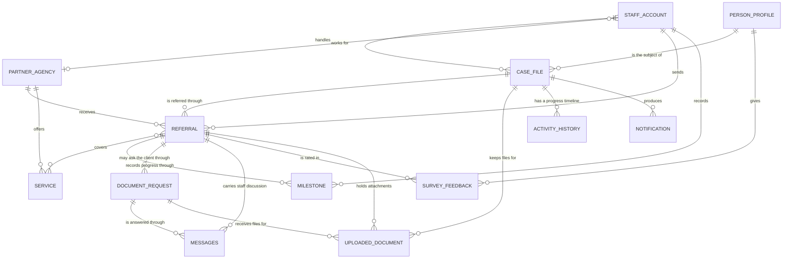

# 04 — Business Information Model

> **Version:** 2.0 (plain-language rewrite) | **Date:** 2026-10-11 | **Status:** Draft for review
> **Audience:** DICT reviewers and capstone panelists — this is the plain-language successor to the earlier, technical description of the same number. It describes **what information the system keeps**, not how it is technically stored: no storage-level detail appears here.
> **Scope:** The key business records — person profile, case file, referral, milestones, document requests, messages, uploaded files, surveys and feedback, activity history, notifications — with, for each: what it is, what it holds (in words), how it connects to other records, who owns and updates it, and its lifecycle from creation to closure or archiving. It closes with how the information is looked after: who may see what, retention and archiving, and what happens to deleted records.
> **Not covered here:** Query performance, backup procedure, and the mechanics of the release pipeline.

---

## Table of contents

1. [Purpose and how to read this document](#1-purpose-and-how-to-read-this-document)
2. [How the records connect](#2-how-the-records-connect)
3. [The records](#3-the-records)
   - 3.1 [Person profile](#31-person-profile-the-ofw-or-next-of-kin)
   - 3.2 [Case file](#32-case-file)
   - 3.3 [Referral to a partner agency](#33-referral-to-a-partner-agency)
   - 3.4 [Milestones and progress updates](#34-milestones-and-progress-updates)
   - 3.5 [Document requests](#35-document-requests-an-agency-asking-the-client)
   - 3.6 [Messages and conversations](#36-messages-and-conversations)
   - 3.7 [Uploaded documents and files](#37-uploaded-documents-and-files)
   - 3.8 [Surveys and feedback](#38-surveys-and-feedback)
   - 3.9 [Activity history](#39-activity-history)
   - 3.10 [Notifications](#310-notifications)
   - 3.11 [Accounts, roles and invitations](#311-accounts-roles-and-invitations)
   - 3.12 [Partner agencies, services and reference lists](#312-partner-agencies-services-and-reference-lists)
   - 3.13 [Supporting records](#313-supporting-records)
4. [Data care: who may see what](#4-data-care-who-may-see-what)
5. [Data care: retention, archiving and deleted records](#5-data-care-retention-archiving-and-deleted-records)

---

## 1. Purpose and how to read this document

The system keeps one central set of business records — one place where a person's assistance is described from first contact to closure. Each record below is presented the way an office would describe it: what it is, roughly what kinds of information it holds (described in prose, never listed field by field), how it connects to the other records, who is responsible for keeping it accurate, and how it moves through its life. Section 2 shows how they all connect; sections 4 and 5 explain how the information is protected and kept over time.

---

## 2. How the records connect

Names in this diagram are business names, not storage names. In short: a **person** is the subject of one or more **case files**; a case file is handled by a **case manager** and referred to one or more **partner agencies**; each **referral** carries **services**, **milestones**, **messages**, **document requests**, **files** and a **feedback survey**; **notifications** and the **activity history** follow the case throughout.

---

## 3. The records

### 3.1 Person profile — the OFW or next of kin

**What it is.** The person the assistance is about. One profile per person, created the first time they file or are assisted at the office, and reused if they come back later.

**What it holds.** Identity and contact details (name, email, mobile number, date of birth), home address, overseas work history (employer, positions, countries, contract dates, most recent arrival), emergency contacts (who to call, their relationship and how to reach them), a photo if provided, and whether the person or their next of kin is flagged as vulnerable. Some of this is sensitive and receives extra care (sections 4 and 5).

**How it connects.** A profile is the subject of one or more case files. A public portal account for the OFW can be linked to their own profile so they see only their own cases. Survey feedback is given under the profile.

**Who owns and updates it.** Case managers create and update it during intake and while the case runs; the OFW keeps their own portal details current; administrators can correct records on request.

**Lifecycle.** Created at first contact → updated as circumstances change (new employer, new address, new emergency contact) → remains the standing record while cases are open → follows the retention decision for its cases when those are permanently removed.

### 3.2 Case file

**What it is.** The central record of the whole matter — the "one OFW, one entry" promise. One case file gathers everything about one person's assistance, whichever agencies are involved.

**What it holds.** The office's unique case number, the separate tracking code the public uses, whether the subject is the OFW or their next of kin, a short narrative of the situation, its classification (category and issue type), the filer and reviewer, its status (pending review, open, closed, archived or rejected), key dates such as when it opened, when the person consented to processing and when it closed, where it came from (online self-filing or staff entry), and any escalation, decline or closure reasons recorded along the way.

**How it connects.** Belongs to a person profile; records its filer and reviewer; can hold many referrals, uploaded files, timeline entries and notifications. Categories may await staff classification, but approval requires active category assignments.

**Who owns and updates it.** Case managers create, approve, update, close and archive it; administrators can restore an archived case; the system issues the case number so it is never duplicated or reused.

**Lifecycle.** Saved pending review with a case number and tracking code → approved → open and worked (referrals, updates, documents) → closed when the assistance is finished → archived out of the working list → permanently deleted only after the retention window (section 5). A rejected filing remains a recorded case with its rejection reason, and the person is notified. This is not a draft-and-publish workflow.

### 3.3 Referral to a partner agency

**What it is.** The hand-off of a case — or the part of it that a partner agency handles — for one or more specific services.

**What it holds.** Which agency it went to and for which services, an internal note for the agency, its status (pending, in progress, awaiting requirements, completed, rejected), the agency's decision and, when declined, the reason chosen from the office's standard list, when it was assigned and when the agency first acted (so turnaround can be measured), and the checklist of required documents **as it stood at the moment of referral** — so later changes to an agency's catalogue cannot silently rewrite a referral already under way.

**How it connects.** Belongs to exactly one case file and exactly one agency; covers one or more services from that agency's catalogue; may carry many milestones, messages, document requests and attachments; may receive a feedback survey invitation when completed.

**Who owns and updates it.** The case manager creates it and attaches the OFW's documents; agency staff update its status and decisions and leave notes; administrators oversee everything.

**Lifecycle.** Created as pending → accepted by the agency and worked (in progress, or awaiting requirements while waiting on the client) → completed or rejected with a reason → remains on the case as part of its history and follows the case if it is archived or deleted.

### 3.4 Milestones and progress updates

**What it is.** The ordered checkpoints an agency commits to for a referral, and the updates that show how far the work has got — the "what is happening now" of a referral.

**What it holds.** A title and description for each step, who recorded it, when, any requirement notes attached to it, and, where a milestone exists because the agency asked the client for something, a link to that document request.

**How it connects.** Belongs to one referral, and through it to one case; may be triggered by a document request; feeds the case timeline that clients can see.

**Who owns and updates it.** Agency staff create and update milestones as work advances; case managers read them and follow up through the referral discussion.

**Lifecycle.** Added while the referral is being worked → updated as steps are met → kept as part of the referral's history → removed with the referral if that record is permanently deleted.

### 3.5 Document requests — an agency asking the client

**What it is.** A specific ask addressed to the person: send this document, answer this question, or update this detail. The person answers through a private link — no account, no visit to an office.

**What it holds.** What is being asked (title, plain-language instructions, deadline, and a checklist of individual items), its status (open, in progress, answered, completed, cancelled), who raised it, and a record of each private link issued for it — when it was issued and expires, who issued or revoked it, when it was first and last used and how often, so unusual use can be spotted.

**How it connects.** Belongs to exactly one referral; carries an inbox conversation with the client; may cause the agency to record a milestone; receives the files the client uploads in reply.

**Who owns and updates it.** Agency staff raise it and mark it completed or cancelled; the client answers through the link; the link can be revoked by staff before it expires.

**Lifecycle.** Opened → client responds (in progress → answered) → agency marks it completed (or cancels it) → kept as part of the referral's history.

### 3.6 Messages and conversations

**What it is.** Three kinds of conversation, kept apart on purpose:

1. **Referral discussion** — notes between the case manager and the agency working the referral; individual notes can be marked internal-only so the client-facing side does not see them.
2. **Agency-to-agency coordination** — direct messages between two agencies working the same case, private to those two agencies: case managers and administrators do not read them.
3. **The client inbox** — the thread under a document request where the agency and the link-holding client exchange messages and files, including automatic notes when the request changes.

**What it holds.** Who wrote what and on which side (staff member or link-holding client), when, whether a message was edited, any attachments, and read markers so each agency knows what it has already seen in a shared thread.

**How it connects.** Anchored to a referral (discussion and agency-to-agency) or to a document request (client inbox); attachments belong to the message.

**Who owns and updates it.** Each author owns their message and may edit it (shown to readers as edited); staff can mark messages deleted; unread markers belong to the individual staff member; administrators oversee the whole set.

**Lifecycle.** Written → read → optionally edited or marked deleted → kept with the referral or request it belongs to.

### 3.7 Uploaded documents and files

**What it is.** The actual files behind the records: case documents, referral attachments, the client's uploads in reply to a document request, plus profile pictures and agency logos. The file itself lives in cloud storage; the records only describe it.

**What it holds.** The original file name, type and size, who uploaded it, when, what kind of document it is, and which case, referral or message it belongs to. Referral attachments keep their earlier versions: a replacement file supersedes the previous one while that version stays retrievable, and superseded versions are hidden from the active list. Earlier file copies are kept by the system but agency staff have no screen to replace files or view earlier copies — to be confirmed whether this should ever be offered.

**How it connects.** Belongs to a case file, a referral, or a message in the client inbox.

**Who owns and updates it.** Whoever uploaded it. Case managers and administrators add and replace files; agency staff have no screen to add or replace them; administrators can clean up.

**Lifecycle.** Uploaded → opened only through short-lived links by people entitled to see it → replaced versions kept but set aside → deleted together with its case or referral; files that nothing refers to any more are cleaned up nightly.

### 3.8 Surveys and feedback

**What it is.** After a referral completes, the client is invited to rate how it was handled. Each agency has its own questionnaire, with one active at a time.

**What it holds.** The questionnaire itself (its questions, choice options, order and which are required); the invitation (which case, agency and referral is being rated, a snapshot of the client and service name as at sending, its expiry, and whether it was submitted); and the answers exactly as given.

**How it connects.** An invitation belongs to one referral, one case and one agency; answers belong to the invitation; the invitation goes to the person behind the profile.

**Who owns and updates it.** The agency designs and activates its form; the system issues the invitation automatically when a referral completes, if feedback is enabled, an active agency form and client email exist, and no invitation already exists; the client answers; the agency and DMW review the results.

**Lifecycle.** Form created and activated → invitation issued (it simply expires if unanswered) → answers submitted once and never edited → kept for quality reporting; answers survive later edits to the questionnaire.

### 3.9 Activity history

Two views of history are kept:

1. **Client-facing timeline** — the ordered story shown on the tracking page and portal: request received, case opened, referral sent, status changes, milestones, completion, closure. Entries are written and never edited — a correction is added as a new entry, so the record of what happened stays honest.

2. **Accountability log** — the internal record of who did what across the whole system: creations, changes, deletions, sign-ins and failed sign-ins, exports, publishing, archiving and permanent deletion. Each entry records who acted, a plain description of the action, when, and what the information looked like before and after — with private material such as passwords, two-step secrets and recovery codes shown only as "hidden". Entries are added strictly in order and, while active, cannot be edited or removed; each entry is linked to the previous one so that any alteration would be caught by the weekly verification.

**How it connects.** Timeline entries belong to a case (and optionally a specific referral); accountability entries name the person who acted and, where relevant, the record they touched — and they outlive that record, so a permanently deleted case still has a history explaining what happened.

**Who owns and updates it.** The system writes most entries automatically; case managers and agency staff cause them by acting; administrators read the accountability log, and may extract a limited date range of it — an extraction that is itself recorded.

**Lifecycle (accountability log).** Written at the moment of the action → stays in the live list for about a year → each completed month is sealed into a read-only archive → live entries for archived months are then removed; nothing is removed before its archive exists.

### 3.10 Notifications

**What it is.** Messages raised by events — a new intake, a status change, a new milestone, a staff-requested overdue reminder — delivered inside the portal for staff and portal users, and by email to clients with a link back to the right place.

**What it holds.** What happened (headline and body), when, whether it has been read, and the link to the related case or referral. Client-facing notifications are kept per case so the story stays together.

**How it connects.** Belongs to a case; produced by events on cases and referrals; the email side is mirrored in the delivery ledger (section 3.13).

**Who owns and updates it.** The system creates them; the recipient reads them; nobody edits them.

**Lifecycle.** Raised by an event → delivered → read (or left unread) → kept with the case; stale working copies are trimmed, while the fact that a notification formed part of a case's history remains in the case's own timeline.

### 3.11 Accounts, roles and invitations

**What it is.** Everyone who signs in: case managers, agency staff, administrators, and OFWs for their personal portal.

**What it holds.** Display name, login email, the password (kept unreadable), the person's role, which agency they belong to (if any), profile and contact details, onboarding progress, notification preferences, and their two-step verification status — with its secret and backup codes kept protected and never displayed back on any screen. It also records whether the account is active.

**How it connects.** An account belongs to at most one agency; an OFW account may link to that person's profile; accounts are the authors of cases, referrals, milestones, messages and accountability entries.

**Who owns and updates it.** Administrators create accounts, send one-time invitations (valid for a week, usable once), deactivate and delete them; each user maintains their own profile, password and two-step setup.

**Lifecycle.** Invited → registered and email verified → active with two-step verification set up → deactivated when someone leaves (and signed out immediately) → deleted. Deactivated and deleted accounts cannot sign in. Password-reset records and sign-in sessions are kept only as long as they are useful.

### 3.12 Partner agencies, services and reference lists

**Partner agency directory.** Who the partners are: name, short code used in lists and reports, description, contact details, location and map link, logo, and whether the agency is currently open for new referrals. Owned and maintained by administrators.

**Service catalogue.** What each agency delivers: the service name and description, its expected turnaround in days, and the checklist of documents it requires. Owned by the agency (with administrator oversight), and copied into each referral at referral time so an in-flight referral keeps the checklist it started with.

**Reference lists and settings.** What administrators can tailor without a developer: the status labels and colours used for cases and referrals, case categories, issue types, and general settings such as retention windows and feature switches. System-required entries cannot be removed while records still use them.

### 3.13 Supporting records

- **Reports and exports** — current report and entity exports run during the request. Reports record an attempt and an outcome; case, client and referral exports record an action before generation, not proof of a completed download. Older generated-document records remain in storage but do not describe this current path.
- **Email delivery ledger** — one line for every message the system tried to send: recipient, subject, status, timing, and the outcome reported by the mail provider (delivered, bounced, complained). Read by administrators on the email-log page, with its delivery events; provider acceptance alone does not prove delivery.
- **Staff invitations** — who was invited, to which role and agency, by whom, when it expires, and whether it was used or cancelled. The invitation itself is emailed once; what is stored cannot be used to open it again.
- **Case numbering** — a running count per month, so case numbers are unique within the office and never reused.

---

## 4. Data care: who may see what

- **By role.** Case managers see office-wide cases; agency staff see only the referrals addressed to their agency; administrators see everything, for oversight and support; an OFW account sees only cases belonging to their own profile; a member of the public with a tracking code sees only that case's status and timeline. These limits are applied consistently across screens, reports and exports — not merely hidden on one page.
- **By private link.** A document-request link opens only that one request — never the whole case or other requests — and only until it expires or is revoked. A tracking code, confirmed by a one-time code to the email on file, reveals only that case's status.
- **Between agencies.** Coordination messages between two agencies on a case are visible only to those two agencies — not to case managers, not to administrators.
- **Inside a referral.** Notes marked internal-only stay inside the referring office; anything written as client-facing may appear on the client's timeline.
- **Sensitive material.** Passwords, two-step secrets and backup codes are never displayed anywhere. The accountability log shows what changed but hides those items. Invitation and survey links are stored only as unreadable fingerprints, so they cannot be reconstructed from stored information. Certain sensitive personal details — date of birth, street address, employment details, emergency contacts — are kept in protected form, and staff see only what their role needs to do its work.
- **Extractions.** Producing a copy of information (case lists, reports, the accountability log) is a deliberate, logged action; extracts of the accountability log are bounded by date range and by size, so the log cannot be quietly siphoned off.

---

## 5. Data care: retention, archiving and deleted records

- **Deletion is reversible first.** Most business records are not erased when someone deletes them: they are marked as deleted, together with who deleted them and when, and disappear from ordinary screens. An administrator can restore them. Deleting a case file also hides its referrals and files; deleting a referral also hides its discussion, attachments, milestones and document requests — so nothing is left half-visible.
- **Permanent removal happens only on schedule.** Trashed case files are permanently deleted only after the retention window the administrators have set — by an automated nightly housekeeping pass, never by an ordinary user's click. Reference lists cannot be removed while records still use them. Files are removed with the records they belong to, and files nothing refers to any more are cleaned up nightly.
- **The accountability log is never quietly changed.** Entries are added only, in order, and cannot be edited or removed while in the live window. Each month is sealed into a read-only archive before anything is pruned, and a weekly check confirms the live history still lines up with its archives — so any tampering would show up. The log's entries also outlive the records they describe: permanently deleting a case does not erase the history of who deleted it.
- **Client timeline entries are never edited either** — a correction appears as a new entry, so the public story cannot be rewritten after the fact.
- **Emails and notifications.** The delivery ledger is a working record and may be trimmed over time; the fact that a message formed part of a case's history remains in the case's own timeline and notifications.
- **Feedback answers** are kept for quality reporting and are never edited after submission; they survive later changes to the questionnaire.
- **Personal details follow their case.** Retention decisions for a person's profile are made together with the case files they exist to serve: when a case is permanently deleted past the retention window, the office's retention policy governs what else must go with it.

---

*End of document 04. How the system moves information from request to result — signing in, approvals, emails, errors and operation — is described in document 03, system flow and architecture.*
