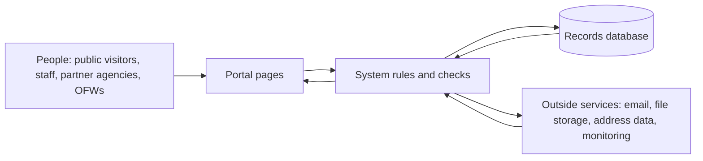

# 07 — Connections and Exchanges

| | |
|---|---|
| **Version** | 1.1.0 |
| **Date** | 2026-11-01 |
| **Scope** | How information moves between the portal, the public pages, the records database, and outside services — described in plain business language |
| **Audience** | DICT reviewers, capstone panelists, business stakeholders, non-technical auditors |
| **Out of scope** | Credentials and secrets (never documented in this set), technical interface specifications, internal programming detail |

> This document deliberately avoids technical terms. It explains *who sends what to whom, and when* — not how it is implemented. See the [reading guide](README.md) for how the set is organised.

---

## Table of Contents

1. [How information moves](#1-how-information-moves)
2. [What the public can submit and receive](#2-what-the-public-can-submit-and-receive)
3. [What staff can exchange with partner agencies and OFWs](#3-what-staff-can-exchange-with-partner-agencies-and-ofws)
4. [Outside services the system uses](#4-outside-services-the-system-uses)
5. [Automatic and background exchanges](#5-automatic-and-background-exchanges)
6. [What happens when something fails](#6-what-happens-when-something-fails)

---

## 1. How information moves

Three parts are involved in every exchange:

- **The portal** — the pages and forms people see in their browser: the public site, the staff workspace, the partner-agency workspace, and the OFW account pages.
- **The system** — the rules that sit behind the pages: who is allowed to do this, is the information complete, is this person who they claim to be, is this submission a duplicate of an earlier one.
- **The records database** — where cases, clients, referrals, messages, documents, and settings are stored, and from which lists, dashboards, and reports are produced.

A person never writes to the database directly. Every action travels from their browser to the system, the system checks it, and only then is the information stored or read back. Nothing a user types is trusted until those checks pass.

Two further points shape every exchange:

- **Signed-in versus public.** Staff, administrators, partner agencies, and registered OFWs sign in with an email address and password, plus a one-time code from an authenticator app where that is required; the system then remembers that session. Filing a case requires creating an account and signing in. Tracking a case has two paths: on the public tracker (tracking number plus a one-time email code) and in the portal when signed in. Public visitors who have not signed in prove who they are with a private link or a one-time code sent to their email address (document-request replies, surveys, contact).
- **Everything of consequence is recorded.** Significant actions are written to an activity trail that shows who did what and when. Filings are saved pending review; approval opens the existing case rather than publishing a draft.

### Principal exchanges

| Exchange | Who is involved | What moves | When |
|---|---|---|---|
| Signing in and account recovery | Any user and the system | Email address, password, one-time codes | When someone signs in, resets a password, or confirms an email address |
| Public self-filing | Signed-in OFW and the system | Personal, address, employment and vulnerability details; consent; a case record pending review | When a signed-in OFW files a case from the portal |
| Case tracking | Public visitor and the system | Tracking number plus a one-time email code in; case status and referral progress out | When an applicant checks how their case is going |
| Case work | Case managers and administrators | Case details, OFW documents, statuses, notes | Throughout the life of a case |
| Referral hand-off | DMW and a partner agency | The referral, progress steps, messages, attachments, internal comments | When a case is shared with another agency for action |
| Client document requests | Partner agency and an OFW, through the portal | A request for a document, a time-limited access link, messages, attachments | When an agency needs something from the person they are assisting |
| Reports and exports | Staff and the system | Summary figures, spreadsheets, printable reports | On demand, when someone asks for them |
| Notifications | The system and its users | In-app notices and emails | Automatically, when something assigned to or affecting them changes |

## 2. What the public can submit and receive

**Without an account, a member of the public can:**

- Read the public pages: home, partner-agency directory and profiles, contact, privacy, terms, and the helpdesk articles (with search and guided answers from a help assistant).
- Send a contact message.
- Answer a satisfaction survey opened from a private link.

**After creating an account and signing in, an OFW can:**

- File a case: personal details, address, employment history, vulnerabilities, next of kin, and consent. The system checks for a possible duplicate of an earlier filing, and the result becomes a saved case pending staff review.
- Track their case on the public tracker (tracking number plus a one-time email code) and in the portal when signed in, and see the case status and the progress of each referral.

**Using a tracking number or a private access link, a person can:**

- See a service request raised for them by an agency (for example, a document the agency needs), send a message about it, ask for a replacement document, and download files shared with them.
- Open an OFW account from their tracking session so they can follow their case over time.

**What the public receives back:** one-time codes and confirmation emails, their case status and referral progress, any documents shared with them, and survey invitations. Public forms limit repeated attempts from the same visitor so they cannot be flooded, and a bot check guards the forms that accept submissions.

## 3. What staff can exchange with partner agencies and OFWs

- **Case managers and administrators** create and edit case files, review self-filed submissions in a review queue (accepting or rejecting them), attach and share OFW documents, manage statuses, produce spreadsheet and printable exports, and read the activity trail.
- **Partner agencies** receive the referrals shared with them and only those. They can update status, add progress steps, comment among themselves, exchange messages with DMW on the referral, read the documents the office attached when it sent the referral, list their service requirements, raise document requests to the person they are assisting, issue and withdraw time-limited access links for those requests, close and reopen requests, design surveys, and maintain the catalogue of services they offer.
- **OFWs with an account** see their own case, its progress steps, their notifications, and their own profile — nothing belonging to anyone else.
- **Administrators** manage user accounts and invitations, the reference lists the whole system draws on (agencies, case categories, case statuses, services), system settings, the activity trail, and authorized report and entity exports. The full-data workbook page is retired.

The boundary rule throughout: each role sees only its slice. A partner agency sees its own referrals and their cases; an OFW sees only their own case; case managers see office-wide cases, not only records assigned to themselves.

## 4. Outside services the system uses

The portal leans on a small number of outside services, each doing one job:

| Outside service | What it does for the system | What depends on it |
|---|---|---|
| **Email delivery** | Sends one-time codes, verification and password-reset links, notifications, and reminder messages. Delivery results — sent, delivered, failed, or reported by the recipient — come back automatically and are recorded against each message. | Registration and tracking codes, password recovery, notifications, reminders |
| **Cloud file storage** | Keeps case documents, referral attachments, and client-request files. Uploads routed through the storage service call the configured scanner before storage, but scanning can be disabled and scanner outages can be allowed through by configuration. Downloads use short-lived links and unused files are cleaned up regularly. Profile images can use an optional image service. | All document exchange |
| **Philippine address reference data** | Supplies the address list used by the forms, refreshed by an explicit data-sync command. | Self-filing and case address fields |
| **Bot and abuse protection** | Checks that the visitor on a public form or the sign-in page is human, and blocks the submission if the check fails. | Public forms and sign-in |
| **Sign-in security** | One-time codes from an authenticator app, backup recovery codes, and protections that stop a hijacked session from being reused. | Access to every staff, agency, and OFW account |
| **Error and health monitoring** | Reports unexpected errors and failed background jobs to the operators, and answers routine health checks that confirm the database, the email service, and the background jobs are all responding. | Operational awareness |

## 5. Automatic and background exchanges

Some exchanges happen without anyone pressing a button:

| Exchange | Who is involved | What moves | When |
|---|---|---|---|
| Background email sending | The system and recipients | Notifications, one-time codes, resets, reminders | Continuously; messages are sent after the related record is safely saved, and retried if a send fails |
| Overdue referral reminders | DMW staff and partner agencies | Reminder emails listing referrals past their due date | On request by staff who can see the overdue list |
| Satisfaction surveys | Partner agencies and respondents | Survey invitations by private link; responses recorded and summarised | After referral completion, if feedback is enabled, an active agency form and client email exist, and no invitation already exists |
| Reports and dashboards | Staff and the system | Summary figures and charts; spreadsheet and printable exports | On demand |
| Activity-trail housekeeping | The system itself | Old log entries tidied; the activity trail archived, pruned only when covered by a finished archive, and checked regularly so it remains tamper-evident | Nightly and weekly, monthly for archiving |
| Retention clean-up | The system itself | Deleted cases removed once their retention period expires; unused stored files removed; stale files tidied | Daily |
| Help-desk knowledge refresh | The system itself | The help articles are re-prepared so search and the help assistant stay fast | After changes to the help content or an explicit refresh |
| Health heartbeat | The system and its monitors | A small "still running" signal from the scheduled jobs, checked by monitoring | Every minute |

## 6. What happens when something fails

Stated in plain words:

- **An email cannot be sent.** It is queued and retried automatically. If it keeps failing, the failure is recorded for operators and administrators can find it by recipient on the email-log page, along with any provider delivery events; there is no resend action. The person sees a friendly message rather than a raw error.
- **The bot or abuse check cannot be reached.** The submission is blocked rather than let through. This is the safe default, but it means an outage at that outside service could temporarily stop legitimate visitors from submitting — the fallback procedure for that case should be written down.
- **A file fails its malware scan.** Where a scanner is configured and blocking, the file is not stored and the uploader is told. With the default settings — no scanner, and failures allowed — the upload is accepted.
- **Someone submits twice.** Self-filing accepts the second filing; there is no active-case duplicate check on citizen intake. Repeated attempts are limited per visitor, and the person sees a plain message with a reference number they can quote.
- **A report or export is too heavy.** Producing large spreadsheets or printable reports happens while the request is being served. Under a burst of simultaneous exports the site can slow down or fail for everyone — a known weakness recorded in [08](08-technical-findings-and-recommendations.md).
- **The database is unavailable.** Visitors and staff see a friendly "temporarily unavailable" page instead of an error.
- **A scheduled job fails.** Monitoring alerts the operators. The job does not restart itself, so the affected clean-up or check stays delayed until someone acts.
- **Something unexpected happens.** The person sees a friendly error page carrying a reference number; the same reference number appears in the operators' logs, so one incident can be traced end to end.

---

*End of document 07. See [08 — Strengths, Risks, and Next Steps](08-technical-findings-and-recommendations.md) for what works well and what should be improved.*
